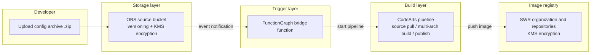

# DevContainer Image & Feature CI Pipeline

[](LICENSE)
[](https://support.huaweicloud.com/intl/en-us/)

> An automated DevContainer image and feature build-and-publish pipeline on Huawei Cloud. Upload a DevContainer configuration archive and the pipeline compiles it into multi-architecture container images and publishes them to the container registry.

---

## Overview

This reference architecture delivers an automated DevContainer image and feature build-and-publish pipeline on Huawei Cloud. It compiles DevContainer configuration archives into multi-architecture (AMD64 / ARM64) container images and publishes them to the container registry. It targets DevOps engineers and platform teams, and serves as a reference architecture or production template.

### Core capabilities

- **Upload-to-trigger**: uploading a configuration archive to the source object bucket automatically starts the build.
- **Multi-architecture images**: produces AMD64 and ARM64 images and merges them into a multi-architecture manifest.
- **Feature publishing**: publishes DevContainer features to the image registry.
- **End-to-end orchestration**: the pipeline orchestrates source pull → build → test → publish.

---

## Architecture

> Developer uploads a DevContainer configuration archive → OBS event notification → FunctionGraph bridge function → starts a CodeArts pipeline → multi-architecture build and publish to SWR.



**Key components**:

- **OBS source bucket**: stores DevContainer configuration archives and the function code package; versioning and KMS server-side encryption enabled.
- **FunctionGraph bridge function**: parses the OBS event, identifies image / feature type, and calls the pipeline start interface.
- **CodeArts pipeline**: orchestrates build tasks per image / feature, completing compilation, multi-architecture merge, test, and publish.
- **SWR**: hosts the final published DevContainer images and features for teams to pull.

---

## Key Features

- **Fully automated**: configuration changes trigger the build automatically, with no manual intervention.
- **Native multi-architecture support**: produces AMD64 and ARM64 images and merges them into a multi-architecture manifest.
- **Encryption by default**: object storage and image registry both enable KMS server-side encryption; no secrets written into files.
- **Observable state**: pipeline stage status and build logs are viewable in real time on the console.

---

## Cloud Services

| Service | Role |
|---|---|
| OBS | Source and artifact object storage (versioning + KMS encryption) |
| KMS | Managed encryption keys reused by OBS and SWR |
| SWR | Container image and feature registry (organization + repositories) |
| FunctionGraph | Bridge function that routes OBS events to the pipeline |
| CodeArts | Build and publish pipelines (image / feature) |
| IAM | Agency (delegation) that grants the build and function runtime permissions |

---

## Prerequisites

- A Huawei Cloud account with access to OBS, KMS, SWR, FunctionGraph, and CodeArts in the `cn-north-4` region.
- Terraform 1.9.x and the `huaweicloud/huaweicloud` provider (v1.97.x).
- An IAM agency (delegation) of type "cloud service → FunctionGraph", granting `SWR Administrator`, `OBS OperateAccess`, and `KMS DecryptAccess`. Provide its name through `build_agency_name`.
- A CodeArts project. Provide its project ID through `codearts_project_id`.
- Credentials (access key / secret key) used only as environment variables during deployment; do not write them into any file.

---

## Quick Start

1. Clone this repository.
2. Copy `infra/terraform.tfvars.example` to `infra/terraform.tfvars` and fill in the variables (region, project name, bucket names, organization, agency name, project ID).
3. Set the credentials as environment variables in your terminal session before running Terraform.
4. Initialize and apply:
   ```bash
   cd infra
   terraform init
   terraform plan
   terraform apply
   ```

---

## Deployment

1. Provision the storage, encryption, and registry layer (KMS key, OBS buckets, SWR organization and repositories). These resources deploy and are read back from the cloud to confirm.
2. Provision the FunctionGraph bridge function and the CodeArts pipelines. These reference the IAM agency and CodeArts project you prepared in Prerequisites.
3. Upload a DevContainer configuration archive to the OBS source bucket to trigger the end-to-end build.

> Note: the FunctionGraph function and CodeArts pipelines depend on the IAM agency and CodeArts project being available in your account. If they are not yet prepared, those resources cannot be created; the rest of the infrastructure still deploys successfully.

---

## Usage

- **Publish an image**: upload `devcontainers/images/<id>.zip` to the OBS source bucket; the bridge function starts the image pipeline; the built image is pushed to the corresponding SWR repository.
- **Publish a feature**: upload `devcontainers/features/<id>.zip`; the feature pipeline publishes it to the SWR feature repository.
- **Pull**: teams pull the published images / features from SWR using the standard container tooling.

---

## Cleanup

To avoid ongoing charges, destroy the managed resources after validation:

```bash
cd infra
terraform destroy
```

The managed resources (KMS key, OBS buckets, SWR organization and repositories) are removed, and the Terraform state is cleared. Keep `infra/.terraform.lock.hcl` as a normal deliverable.

---

## License

This repository is licensed under **MIT No Attribution (MIT-0)**. See the [LICENSE](LICENSE) file for details.

---

## Contact

| Field | Value |
|---|---|
| **Creator** | zhangcheng123321 |
| **Maintainer** | zhangcheng123321 |

For questions or contributions, open an issue or a pull request in the repository.

---

*Reference architecture for an automated DevContainer image and feature build-and-publish pipeline on Huawei Cloud.*
