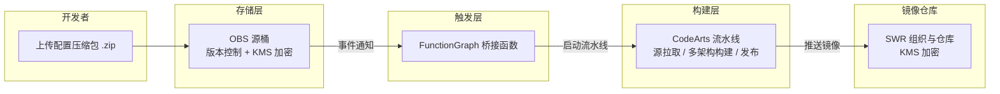

# DevContainer 镜像与特性自动化构建发布流水线 / DevContainer Image & Feature CI Pipeline

[](LICENSE)
[](https://support.huaweicloud.com/intl/en-us/)
[](#)

> 将 DevContainer 配置压缩包自动构建为多架构镜像并发布到容器镜像仓库的一站式流水线
> Automated DevContainer image & feature build-and-publish pipeline on Huawei Cloud

---

## 1. 简介 / Overview [CRITICAL]

**中文**：本实践提供一套基于华为云的 DevContainer 镜像与特性自动化构建发布能力，用于把 DevContainer 配置压缩包自动编译为多架构容器镜像并发布到容器镜像仓库。面向 DevOps 工程师与平台工程团队，可作为内部开发镜像仓库的参考架构与生产模板。

**English**: This reference architecture delivers an automated DevContainer image and feature build-and-publish pipeline on Huawei Cloud, compiling DevContainer configuration archives into multi-architecture container images and publishing them to the container registry. It targets DevOps engineers and platform teams, and serves as a reference architecture or production template.

### 核心能力

- **配置上传即触发**：向源对象存储桶上传配置压缩包即自动启动构建
- **多架构镜像**：同时产出 AMD64 与 ARM64 镜像并合并为多架构清单
- **特性发布**：支持将 DevContainer 特性（features）发布到镜像仓库
- **端到端编排**：由流水线统一编排「源拉取 → 构建 → 测试 → 发布」

---

## 2. 目录 [MINOR]

- [1. 简介](#1-简介--overview-critical)
- [2. 目录](#2-目录-minor)
- [3. 架构图](#3-架构图-minor)
- [4. 方案亮点](#4-方案亮点-minor)
- [5. 涉及云服务](#5-涉及云服务-minor)
- [6. 前置条件](#6-前置条件-critical)
- [7. 快速开始](#7-快速开始-critical)
- [8. 分步部署](#8-分步部署-minor)
- [9. 使用方法 / 验证](#9-使用方法--验证-critical)
- [10. 清理资源](#10-清理资源-minor)
- [11. 详细说明](#11-详细说明-minor)
- [12. 依赖](#12-依赖-minor)
- [13. FAQ / 故障排除](#13-faq--故障排除-minor)
- [14. 贡献指南](#14-贡献指南-minor)
- [15. 许可证](#15-许可证-critical)
- [16. 联系方式 / 维护者](#16-联系方式--维护者-critical)

---

## 3. 架构图 [MINOR]

> 开发者上传 DevContainer 配置 → OBS 事件通知 → FunctionGraph 桥接函数 → 启动 CodeArts 流水线 → 多架构构建并发布到 SWR。



**关键组件说明**：
- **OBS 源桶**：存放 DevContainer 配置压缩包与函数代码包，启用版本控制与 KMS 服务端加密
- **FunctionGraph 桥接函数**：解析 OBS 事件，识别镜像 / 特性类型，调用流水线启动接口
- **CodeArts 流水线**：按镜像 / 特性分别编排构建任务，完成编译、多架构合并、测试与发布
- **SWR**：托管最终发布的 DevContainer 镜像与特性，供团队拉取使用

---

## 4. 方案亮点 [MINOR]

- **全自动化**：配置变更自动触发，无需人工介入构建流程
- **多架构原生支持**：同时产出 AMD64 与 ARM64 镜像并合并为多架构清单
- **默认加密**：对象存储与镜像仓库均启用 KMS 服务端加密，凭据不落盘
- **状态可观测**：流水线各阶段状态、构建日志可在控制台实时查看

---

## 5. 涉及云服务 [MINOR]

| 服务 | 用途 | 备注 |
|---|---|---|
| 对象存储服务 OBS | 存放 DevContainer 配置压缩包与构建产物 | 启用版本控制与 KMS 加密 |
| 容器镜像仓库 SWR | 托管构建出的 DevContainer 镜像与特性 | Software Repository for Containers |
| 流水线服务 CodeArts Pipeline | 编排「源拉取 → 构建 → 发布」全流程 | 构建任务内联编译镜像 |
| 函数工作流 FunctionGraph | 桥接 OBS 事件与流水线启动 | OBS 原生触发器 |
| 密钥管理 KMS | 为 OBS 与镜像仓库提供服务端加密密钥 | 托管密钥，不暴露明文 |
| 统一身份认证 IAM | 提供构建委托（Agency）所需权限 | 授予 SWR / OBS / KMS 访问 |

> **提示**：所有服务均可通过本仓库的 Terraform 一键创建；如需清理，请参见 [第 10 节「清理资源」](#10-清理资源-minor)。

> **资源规格与用量说明**：各服务的规格与部署用量说明随仓库配套文档提供，不在此处展开。

---

## 6. 前置条件 [CRITICAL]

| 项 | 要求 | 说明 |
|---|---|---|
| **账号** | 已开通华为云账号并完成实名认证 | 个人 / 企业账号均可 |
| **权限** | 账号具备 IAM **Tenant Administrator** 或等效权限 | 用于创建 OBS / SWR / CodeArts / FunctionGraph / KMS 等资源 |
| **Region** | 推荐 `cn-north-4` | 区域需支持上述全部服务 |
| **Terraform** | `>= 1.5.0` | IaC 部署工具 |
| **huaweicloud Provider** | `>= 1.97.0` | 华为云 Terraform Provider |
| **Node.js** *(构建环境)* | `>= 18` | 用于安装 `@devcontainers/cli` |
| **Docker** *(构建环境)* | `>= 20.10` | 镜像构建与推送 |
| **AK/SK** | 已创建访问密钥，并在部署前于终端会话中临时设置 | **请勿将密钥写入任何文件** |

> **凭据准备方式**：
> ```bash
> export TF_VAR_access_key="<your-access-key>"
> export TF_VAR_secret_key="<your-secret-key>"
> ```
> 仓库内任何 `.tf` / 文档均使用占位符，**不出现真实凭据**。

---

## 7. 快速开始 [CRITICAL]

### 一键部署（推荐）

```bash
# 1. 克隆本仓库
git clone <本仓库 HTTPS URL> <本仓库根目录>
cd <本仓库根目录>

# 2. 设置凭据（见前置条件）
export TF_VAR_access_key="<your-access-key>"
export TF_VAR_secret_key="<your-secret-key>"

# 3. 一键部署
cd infra
terraform init
terraform plan
terraform apply -auto-approve
```

> **部署耗时**：约 5-10 分钟（视资源数量而定）。
> **完整步骤与每步预期输出**：参见 [第 8 节「分步部署」](#8-分步部署-minor)。

---

## 8. 分步部署 [MINOR]

### 步骤 1：初始化工作目录

```bash
cd <本仓库根目录>/infra
terraform init
```

**预期输出**：`Terraform has been successfully initialized!`

### 步骤 2：预演资源变更

```bash
terraform plan
```

**预期输出**：`Plan: N to add, 0 to change, 0 to destroy.`

### 步骤 3：执行部署

```bash
terraform apply -auto-approve
```

**预期输出**：`Apply complete! Resources: N added, 0 changed, 0 destroyed.`

### 步骤 4：记录关键输出

```bash
terraform output
```

**预期输出**：列出所有 `output` 字段值（源桶名、SWR 登录端点、流水线名称等），请妥善保存用于后续验证。

---

## 9. 使用方法 / 验证 [CRITICAL]

> **验证指引**：本节列出部署完成后应当执行的验证步骤，用于确认业务功能可用。请在部署完成后按本节步骤自行验证。

### 验证 1：查看关键输出

```bash
cd <本仓库根目录>/infra
terraform output
```

**预期输出**：包含 `source_bucket`、`swr_login_endpoint`、`image_pipeline_names` 等字段。

### 验证 2：上传配置触发构建

```bash
# 将某个 DevContainer 配置目录打包为 zip 并上传到源桶对应路径
zip -r base.zip ./devcontainer-base
obsutil cp ./base.zip obs://<source_bucket>/devcontainers/images/base.zip
```

**预期结果**：OBS 事件触发 FunctionGraph，对应 CodeArts 镜像流水线自动启动。

### 验证 3：查看构建产物

```bash
# 登录容器镜像仓库后在控制台查看，或使用 SWR 命令行
swr image-list --namespace <swr_organization>
```

**预期结果**：出现 `base` 仓库，且包含 `dev-<IMAGE_TAG>` 与 `latest` 标签。

### 验证 4：端到端拉取验证

```bash
docker pull <swr_login_endpoint>/<swr_organization>/base:latest
echo "{ \"image\": \"<swr_login_endpoint>/<swr_organization>/base:latest\" }" > test.devcontainer.json
devcontainer up --workspace-folder . --override-config test.devcontainer.json
```

**预期结果**：镜像成功拉取并启动 Dev Container，开发环境可用。

---

## 10. 清理资源 [MINOR]

```bash
# 进入部署目录
cd <本仓库根目录>/infra

# 一键释放所有资源
terraform destroy -auto-approve
```

**预期输出**：`Destroy complete! Resources: N destroyed.`

> **避免资源残留**：
> - `terraform destroy` 仅释放 Terraform state 中追踪的资源；
> - 若中途使用 API / 控制台直接创建了资源（如手动上传的 OBS 对象），需手动释放；
> - 账号内其他任务共享的公共服务（如共用 VPC）不会被影响。

---

## 11. 详细说明 [MINOR]

### 工作流程

1. 开发者将 DevContainer 配置目录打包为 `.zip`，上传至 OBS 源桶的 `devcontainers/images/<id>.zip` 或 `devcontainers/features/<id>.zip` 路径。
2. OBS 事件通知触发 FunctionGraph 桥接函数，函数解析对象键识别类型与标识符。
3. 函数调用 CodeArts 流水线启动接口，启动对应镜像 / 特性流水线。
4. 流水线依次执行：从源桶拉取配置 → 多架构构建并推送至 SWR → 合并多架构清单 → 冒烟测试 → 发布版本与 latest 标签。

### 配置项

| 变量 | 默认值 | 说明 |
|---|---|---|
| `region` | `cn-north-4` | 部署区域 |
| `project_name` | `devcontainer-factory` | 资源命名前缀 |
| `namespace` | `devcontainers` | 命名空间，用于 SWR 组织与对象存储路径前缀 |
| `build_agency_name` | 无默认值（必填） | 预先创建的 IAM 委托名称 |
| `codearts_project_id` | 无默认值（必填） | CodeArts 项目 ID |
| `obs_source_bucket_name` | `devcontainer-factory-source` | 源对象存储桶名 |
| `obs_artifact_bucket_name` | `devcontainer-factory-artifacts` | 产物对象存储桶名 |
| `swr_organization` | `devcontainers` | 容器镜像组织名 |
| `images` | `["base", "base-extended"]` | 需构建的镜像标识符列表 |
| `features` | `["git-cli", "docker-cli"]` | 需发布的特性标识符列表 |

### 接口 / API

- **OBS 事件通知**：配置 OBS 桶事件（PutObject）触发 FunctionGraph。
- **CodeArts 流水线启动**：由桥接函数调用流水线服务接口启动对应流水线。

---

## 12. 依赖 [MINOR]

### 主要依赖

| 名称 | 版本 | 用途 |
|---|---|---|
| Terraform | `>= 1.5.0` | IaC 编排 |
| huaweicloud Provider | `>= 1.97.0` | 华为云资源 |
| `@devcontainers/cli` | 最新版 | DevContainer 构建与特性发布 |
| Docker | `>= 20.10` | 镜像构建与推送 |

---

## 13. FAQ / 故障排除 [MINOR]

### Q1：部署时提示「权限不足」怎么办？

**A**：确认账号具备 IAM **Tenant Administrator** 权限，或至少包含 OBS、SWR、CodeArts、FunctionGraph、KMS 等子服务管理员权限。

### Q2：上传配置后流水线没有启动？

**A**：检查 OBS 事件通知是否正确配置触发 FunctionGraph；确认 FunctionGraph 的 IAM 委托具备调用流水线服务的权限；查看函数日志确认事件解析与启动调用是否成功。

### Q3：镜像推送 SWR 失败？

**A**：确认 CodeArts 构建环境已正确登录 SWR（凭据通过构建参数注入），且构建委托具备 SWR Administrator 权限。

### 故障排查清单

| 现象 | 可能原因 | 排查方法 |
|---|---|---|
| 流水线未启动 | OBS 事件未触发函数 | 检查 OBS 事件通知配置与函数触发器 |
| 构建登录失败 | SWR 凭据错误或缺失 | 核对构建参数中的 SWR 用户名与密码 |
| 多架构合并失败 | 缺少某一架构的构建产物 | 确认 amd64 / arm64 两条构建任务均成功 |

---

## 14. 贡献指南 [MINOR]

欢迎提交 Issue 与 PR。请遵循以下流程：

1. **Issue**：描述问题 / 建议（含复现命令、预期 / 实际输出、截图）
2. **PR**：基于 `main` 分支新建 feature 分支；提交前运行 `terraform validate` 与门禁脚本
3. **Code Review**：由 zhangcheng123321 审核通过后合并

---

## 15. 许可证 [CRITICAL]

本实践采用 **MIT No Attribution** 许可证发布。详见仓库根目录 [`LICENSE`](LICENSE) 文件。

```
MIT No Attribution

Copyright (c) Huawei Cloud

Permission is hereby granted, free of charge, to any person obtaining a copy
of this software and associated documentation files (the "Software"), to deal
in the Software without restriction, including without limitation the rights
to use, copy, modify, merge, publish, distribute, sublicense, and/or sell
copies of the Software... (no attribution required)
```

---

## 16. 联系方式 / 维护者 [CRITICAL]

| 项 | 内容 |
|---|---|
| **创建者** | zhangcheng123321 |
| **维护者** | zhangcheng123321 |
| **联系方式** | 提交 Issue / PR |
| **反馈渠道** | 提交 Issue / PR（见 [第 14 节](#14-贡献指南-minor)） |
